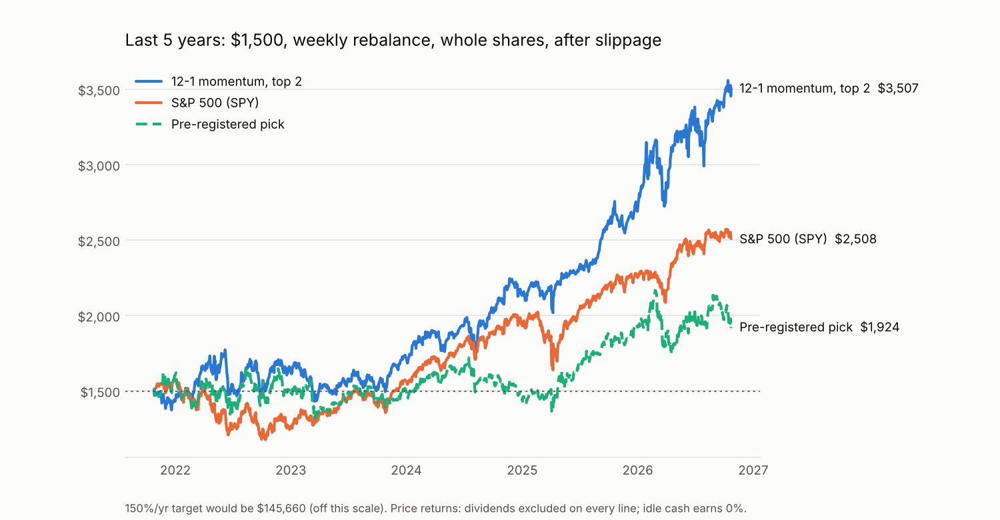

# Backtest results

$1,500 starting cash, weekly rebalance (signals from Friday's close, fills at Monday's
open), whole shares at the real per-share price, 0.05% slippage per fill, SEC fees on
sells, $0 commissions (Schwab), idle cash earns 0%. Returns are **price returns** for
every line, so dividends are left out of the strategy and the S&P 500 alike.

## How the strategy was chosen

1. **Design period, 2005-02 → 2021-10.** 720 weekly variants were tested: two universes
   (11 S&P sector ETFs; the same plus QQQ, IWM, EFA, EEM, GLD, TLT), 5 momentum
   lookbacks, hold the top 1–4 funds, 3 trend filters, with/without volatility
   adjustment and 1-week reversal. Rule fixed before the test: pick the highest return.
2. **Test period, 2021-10 → 2026-10 (the last 5 years), run once.**
3. **The step-1 pick lost to the S&P 500 in step 2**, so a post-hoc step kept only the
   variants that beat SPY in *both* periods (37 of 720) and chose the plain textbook
   momentum rule among them. Because the test period informed that choice, its test
   numbers are **optimistic**; there is no untouched data left to confirm it. Paper-trade
   it (`live_trader` dry run + the weekly email) before risking money.

## Last 5 years (2021-10-25 → 2026-10-23)

| | Final value | Return / yr | Worst drawdown | Sharpe |
|---|---:|---:|---:|---:|
| **12-1 momentum, top 2 (default)** | **$3,507** | **18.6%** | −19.3% | 0.99 |
| S&P 500 (SPY) | $2,508 | 10.8% | −25.4% | 0.68 |
| Pre-registered pick (3/6/12, top 1, vol-adj, reversal) | $1,924 | 5.1% | −21.2% | 0.34 |
| 150%-per-year goal | $145,660 | 150% | — | — |

| Year | Default rule | Pre-registered | SPY |
|---|---:|---:|---:|
| 2021 (from Oct 25) | −4.6% | +6.7% | +4.3% |
| 2022 | **+15.2%** | −7.1% | −19.5% |
| 2023 | +5.0% | +1.6% | **+24.3%** |
| 2024 | +23.3% | −4.2% | +23.3% |
| 2025 | **+26.1%** | +32.6% | +16.4% |
| 2026 (to Oct 23) | **+30.4%** | +0.1% | +11.4% |

Consistency of the default rule over the test: 59.6% of weeks were up, 53.1% of weeks
beat SPY, 57.2% of rolling 1-year windows beat SPY, worst 1-year stretch was 20.5 points
behind SPY. 225 trades in 5 years; the median holding was 2 weeks.

Where the gain came from (test period): gold (GLD) +$664, energy (XLE) +$600 (mostly
2022), emerging markets +$327, tech +$239, communication services +$237, QQQ +$139;
utilities, materials and real estate lost a little. Gold plus energy were ~63% of the
profit, so the result depends on catching a few big trends.

## 2005-02 → 2021-10 (design period)

| | Return / yr | Worst drawdown |
|---|---:|---:|
| 12-1 momentum, top 2 (default) | 12.1% | −41.2% |
| Pre-registered pick | 14.5% | −52.5% |
| SPY | 8.3% | −56.5% |

Across all 720 variants, design-period rank predicted test-period rank only moderately
(Spearman 0.43): the best 5% of design variants had a median test return of 10.2%/yr,
about the same as SPY.

## Read this before trading it

- **150% a year was not reached by anything here, and nothing honest will reach it**
  with unlevered ETFs. The best of all 720 variants on the test window made 35%/yr, and
  that is the luckiest of 720 tries, not a forecast.
- **Taxes:** weekly trading creates short-term gains taxed as ordinary income. In a Roth
  IRA this does not apply.
- **The default rule can trail the S&P for a full year** (2023: +5% vs +24%).
- Data: daily split-adjusted bars for the ETFs; 5 splits in the test window (Dec 2025,
  XLB/XLE/XLK/XLU/XLY 2-for-1) handled so share counts use real prices.

## Earnings play book

Built (`earnings.py`, `earnings_backtest.py`) and unit-tested on synthetic SEC filings,
but **not yet backtested on real data**: it needs SEC EDGAR (`data.sec.gov`), which the
environment that produced these results could not reach. Run it yourself with
`SEC_USER_AGENT="Your Name you@email.com" python -m schwab_trader.earnings_backtest`
after downloading the stock prices (see the README).

Reproduce everything: `python -m schwab_trader.data` then
`python -m schwab_trader.research --phase design|test|robust`.
